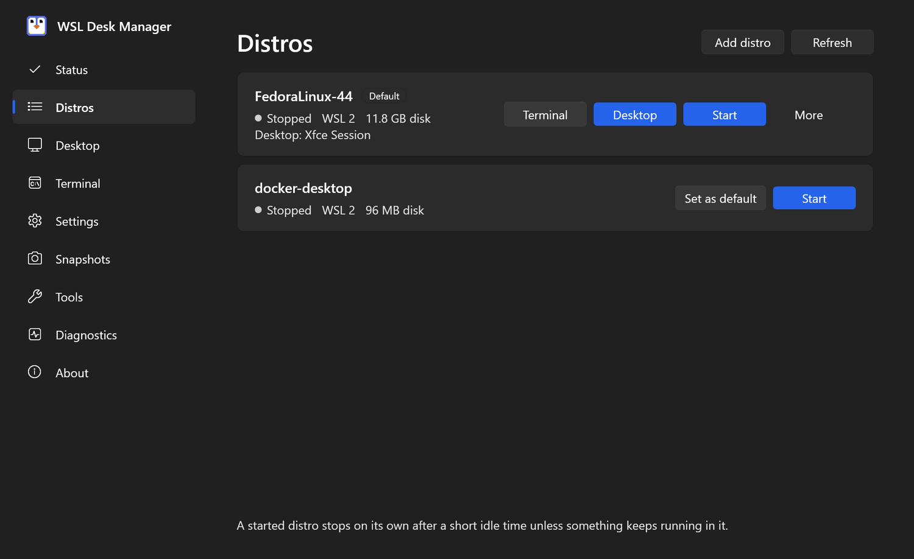
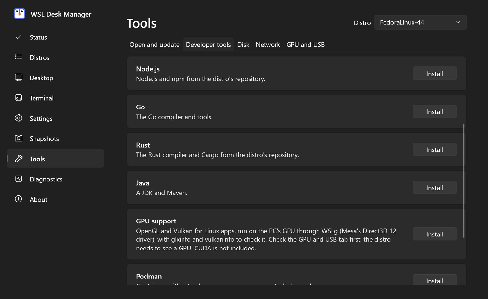
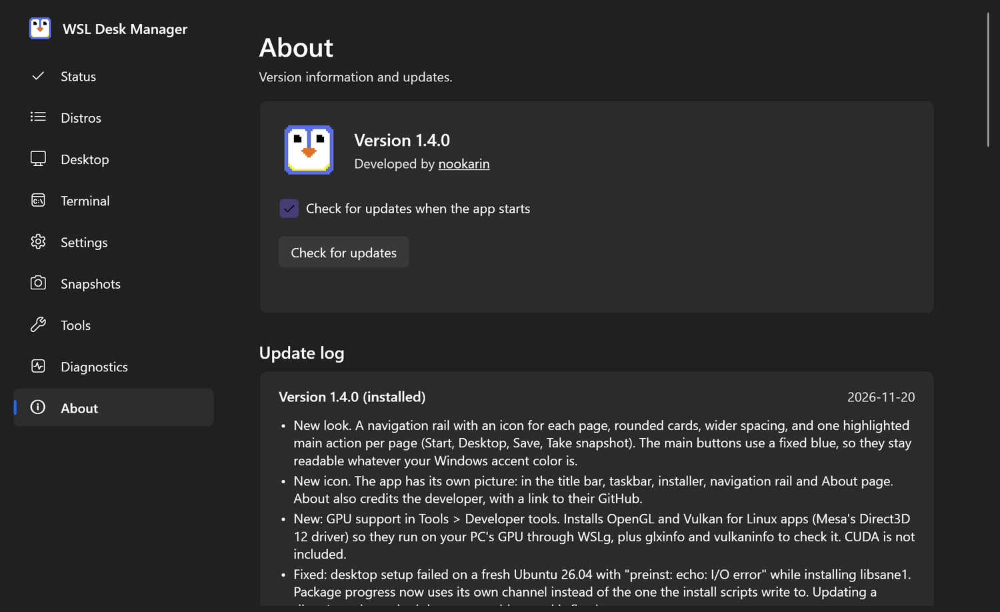

  

<h1 align="center">WSL Desk Manager</h1>

  A Windows app that sets up WSL and opens a Linux distro's full desktop, or a terminal, in a few clicks. 
  Every WSL command is a button, so you never need a command line.

  <a href="https://github.com/nookarin/WSL-Desk-Manager/releases/latest"><b>Download the latest version</b></a>

This repository hosts the installer downloads. Each release has the installer, its SHA-256 checksum,
and a list of what changed.

## Screenshots

**Distros:** start, stop and open every distro from one list.

**Tools:** one-click developer tools, disk, network, GPU and USB for the distro you pick.

**About:** the version, the update check, and what changed in each release.

## Download

Get `WslDeskManager-Setup-<version>.exe` from the
[latest release](https://github.com/nookarin/WSL-Desk-Manager/releases/latest) and run it. Older versions
stay on the [Releases page](https://github.com/nookarin/WSL-Desk-Manager/releases).

## Getting started

1. **Open the app.** The **Status** page checks whether WSL is ready. If it isn't, one button enables
   it (Windows asks for permission once) and the app carries on after the restart.
2. **Add a distro.** On **Distros**, choose **Add distro**: pick one from the online list, or import a
   `.tar`, `.vhdx` or `.wsl` file. The default user is created for you, with no console prompt.
3. **Open it.** Use **Desktop** to install a desktop and see it in a window, or **Terminal** for a
   shell tab. Both are one click.

## What it does

### Status
Checks whether WSL is installed and ready. If it isn't, it enables WSL (one administrator prompt) and
continues after the restart. It also shows the WSL version and can update WSL for you.

### Distros
Lists your installed distros with start, stop, set as default, and convert to WSL 2. Add a distro from the
online list or from a `.tar`, `.vhdx` or `.wsl` file. Installs, restores and clones show real progress.

### Desktop
Installs and configures xrdp and a desktop environment (**Xfce**, **KDE Plasma** or **MATE**) on apt and
dnf distros such as Ubuntu, Debian and Fedora. Then it shows the desktop:
- in a window inside the app,
- full screen, or
- in Windows Remote Desktop.

Setup can be run again at any time and only changes what is missing. Xfce can get a polished look
(theme, icons, app menu, dock and fonts) that matches Windows light or dark and your display scaling.
Desktop passwords are kept in Windows Credential Manager, and xrdp listens on the local machine only by
default.

### Terminal
A terminal tab for each distro, with its own font, theme, cursor and scrollback settings. A distro can
also be opened in Windows Terminal.

### Settings
Display, clipboard (both directions, off, or one way only), keyboard, performance, desktop, terminal, and
the `.wslconfig` and `wsl.conf` files. Each setting says whether it applies right away, at the next
connection, or after a WSL restart. A **Draw at lower resolution** option makes the desktop smoother on
high-resolution screens.

### Snapshots
Save a distro, restore it, or clone it into a new distro. Before a restore, a safety snapshot of the
current state is taken automatically, so a restore can always be undone. Snapshots can be named, noted
and moved to a folder of your choice.

### Tools
Work on one distro at a time, from its **More** menu or the Tools page.

| Tool | What it does |
|---|---|
| **Open and update** | Open the distro in File Explorer, VS Code or Windows Terminal. Check its packages for updates and install them (apt, dnf, zypper, pacman, apk). |
| **Developer tools** | One-click profiles for apt and dnf distros: Essentials, Python, Node.js, Go, Rust, Java, **GPU support** (OpenGL and Vulkan on your PC's GPU through WSLg; CUDA is not included), **Podman** (rootless, no daemon) and **Docker Engine** (the daemon inside the distro, started by systemd). Docker Desktop is left alone, and the page warns if it is installed, because the two can conflict. |
| **Disk** | See how much space the distro uses against its disk file on Windows, give space back to Windows (trim and sparse mode), move the disk to another drive, or rename the distro. |
| **Network** | See the distro's addresses and listening ports, open a port as `localhost`, or forward a port to your network with a Windows port proxy rule. |
| **GPU and USB** | Check whether the distro sees your GPU and WSLg, and share, attach and detach USB devices through usbipd-win. |

### Diagnostics
A report you can copy for bug reports. Passwords and your Windows user name are masked, and nothing is
sent anywhere.

### Appearance and updates
A navigation rail with an icon for every page, in light, dark, or the same as Windows. The app checks for a newer release in the background (at most once
a day), verifies its SHA-256 checksum, and installs it in place.

## Requirements

- Windows 10 22H2 (build 19045) or Windows 11, x64, with virtualization enabled in the firmware.
- The Microsoft Edge WebView2 Runtime, used by the terminal. It comes with Windows 11 and current
  Windows 10.

The installer includes .NET, so nothing else needs to be installed.

## Install and uninstall

Run `WslDeskManager-Setup-<version>.exe`. It installs for your user only, so it doesn't ask for
administrator rights. The app asks for them itself, once, if WSL needs to be enabled.

**Uninstall** from Settings > Apps. Your distros and snapshots are always kept. The uninstaller asks
whether to delete the app's settings, logs and saved desktop passwords too.

## Updates

The app checks this repository's latest release on startup and shows a banner when a newer version
exists. You can also check from **About**, where the startup check can be turned off. The update is
downloaded, checked against the release's SHA-256 checksum, and installed in place. Settings, distros and
snapshots are kept.

## Where things are stored

| What | Where |
|---|---|
| Settings, snapshot list | `%APPDATA%\WslDeskManager\` |
| Logs (kept 14 days) | `%LOCALAPPDATA%\WslDeskManager\logs\` |
| Distros added by the app | `%LOCALAPPDATA%\WslDeskManager\distros\<name>\` |
| Snapshots (the folder can be changed) | `%LOCALAPPDATA%\WslDeskManager\snapshots\<distro>\` |
| Desktop passwords | Windows Credential Manager |

## Known limitations

- **Desktop setup** works on apt and dnf distros (Ubuntu, Debian, Fedora and similar).
- **Developer tool profiles** are for apt and dnf distros. Package updates also cover zypper, pacman and
  apk.
- **Disk-image snapshots:** WSL refuses to export a disk image while its VM is running, even with the
  distro stopped. When that happens the app makes a `.tar` snapshot instead, which is the default format.
- **Move and sparse disk** need a WSL version with `wsl --manage` (update with `wsl --update`). Newer WSL
  treats sparse disks as unsafe and asks for confirmation first.
- **Renaming a distro** changes its name while it is stopped. Shortcuts made elsewhere, such as Windows
  Terminal profiles, keep the old name.
- **USB** needs usbipd-win, and sharing a device needs administrator permission.
- **One-way clipboard modes** work in the window inside the app. Windows Remote Desktop only offers
  clipboard both ways or off.

## Privacy

The app has no telemetry. It contacts GitHub only to check for updates and download them. The
diagnostics report stays on your machine until you copy it somewhere.

## Support

If something doesn't work, open an issue on this repository and paste the report from the app's
**Diagnostics** page.

## Credits

Developed by [nookarin](https://github.com/nookarin).
